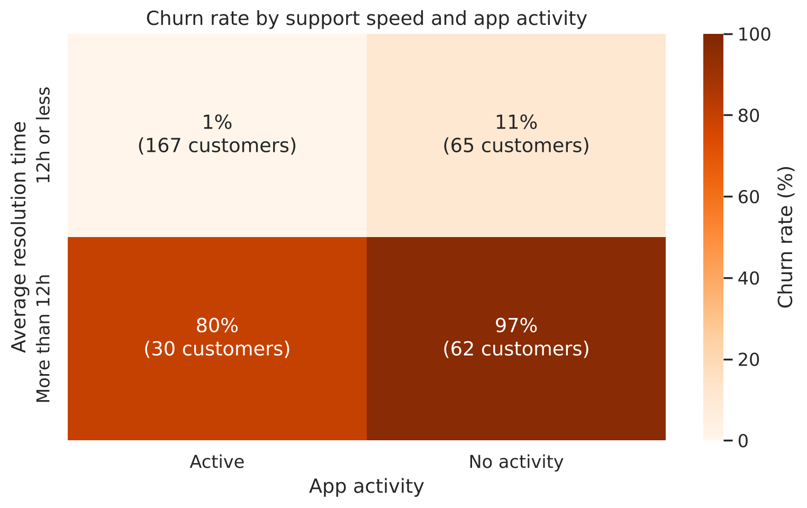
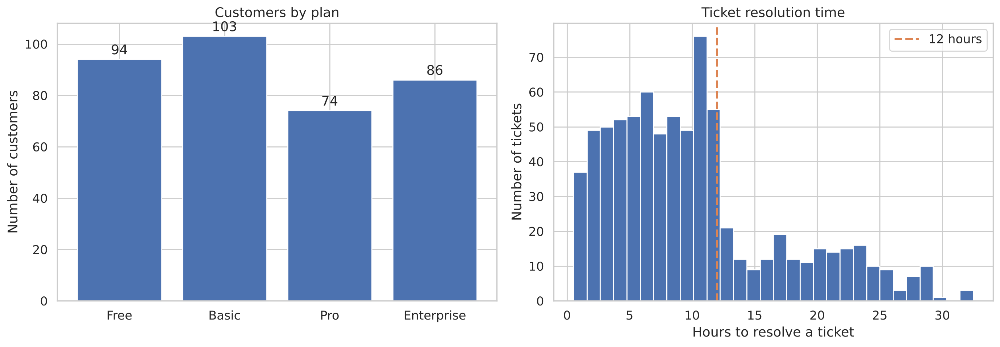
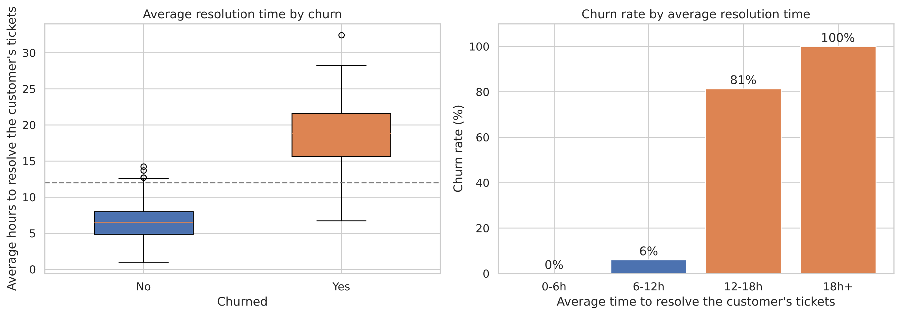
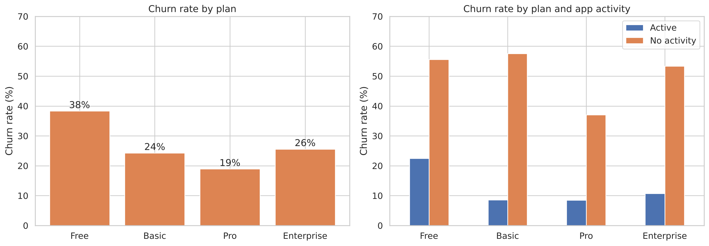
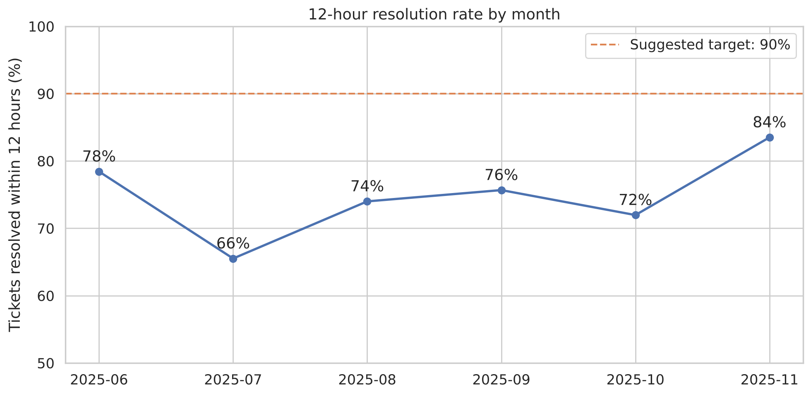

# Churn at Fit.ly

**Why do subscribers cancel, and what can a fitness app do about it?**

A churn analysis for a fictional subscription fitness app. I combined account, customer support and in-app activity data to find the signals that appear before a customer leaves, defined one metric the business can track every month, and turned the findings into four actions.



## The short version

- **27.2%** of customers have cancelled (97 of 357).
- **Slow support is the strongest warning sign.** Customers whose tickets take more than 12 hours to resolve on average churn at 91.3%. Customers whose tickets are solved faster churn at 3.4%.
- **Customers who do not use the app leave too.** Churn is 51.9% with no activity and 12.2% with at least one action.
- **Together these two signals cover 94 of the 97 customers who left.**
- **Plan type matters less than it looks.** Free users churn the most (38.3%), but they are also the least active and wait longest for support.

## The business question

Churn had been rising for two quarters and acquiring new customers was getting more expensive. Leadership asked for three things:

1. What is driving churn?
2. Which number should the business monitor?
3. What can be done next quarter?

The brief asked for engagement, support activity and plan type to be covered, and for the three data sources to be combined before drawing conclusions.

## Data

Three files from three different teams, none of them cleaned or validated upstream.

| Source | Rows received | Rows used | What it holds |
|---|---|---|---|
| Account info | 400 | 357 | Plan, price paid, state, churn status |
| Customer support | 918 | 781 | Ticket time, channel, topic, hours to resolve |
| User activity | 445 | 401 | In-app events (articles, videos, workouts) |

I built this as the practical project for the DataCamp Data Analyst certification, which I passed in 2026. The scenario and the files come from that case study. The company and the customers are fictional. The raw files are not included in this repository (see [`data/README.md`](data/README.md)).

## How I worked

**1. Validation and cleaning.** Every column in the three files was checked against the data dictionary and against what the Product Manager and the Lead Engineer said about the systems. The main decisions:

| Issue | What I did | Why |
|---|---|---|
| 43 customers asked for their data to be deleted (GDPR) | Removed them from all three tables | A legal requirement, and the only rows removed |
| Churn column held only `Y` or blank | Blank became "No" | Customers are only marked once they cancel |
| IDs were `C10000` in one table and `10000` in the others | Built a matching `user_id` | Needed to join the tables |
| Support `state` held 0 and 1 instead of a US state | Replaced it with the state from the account table | Location comes from billing data |
| 35 tickets had `-` as the channel | Relabelled as `unknown` | Keeps the tickets in the analysis |
| No sign-up date or cancellation date | Flagged as a gap | Limits what the data can prove (see below) |

**2. One view of each customer.** I joined the sources into one row per customer with plan, churn, number of tickets, average resolution time and number of in-app events. Customers with no activity were counted as having zero events. Customers with no tickets keep an empty resolution time rather than an invented one.

**3. Exploration.** Single-variable charts first (customers per plan, ticket resolution time), then relationships (churn by plan, activity, support speed and the two combined).



Most tickets close within half a day (median 8.7 hours), but there is a long tail. About one ticket in four takes more than 12 hours, and that tail is where the problem sits.

## What I found

### Support speed

Churn is 0% when a customer's tickets are solved in under 6 hours, 6% between 6 and 12 hours, 81% between 12 and 18 hours, and 100% above 18 hours. The ticket topic and channel make little difference. How long customers wait is what matters.



### Engagement and plan type

Customers with no app activity churn at 51.9%. The pattern holds across every plan, so Free's high churn is mostly a story about low engagement.



### Both signals together

| | Uses the app | No app activity |
|---|---|---|
| **Tickets solved within 12 hours** | 1% (167 customers) | 11% (65) |
| **Tickets over 12 hours** | 80% (30) | 97% (62) |

Churned customers account for 24.3% of the total plan value (3,929 of 16,159 in list price), and about two thirds of that comes from Enterprise.

## The metric to monitor

**Share of support tickets resolved within 12 hours, per month.**

It reacts while the customer is still there, while churn itself only shows the problem after the customer has gone. The 12-hour line is where churn jumps from 6% to 81% in this data, and the support team can act on it directly.

| Measure | Baseline | Suggested target |
|---|---|---|
| Tickets resolved within 12 hours | 74.1% | 90% |
| Active customer rate (supporting metric) | 62.2% | n/a |
| Churn rate (outcome metric) | 27.2% | falling |

Monthly values ranged from 66% in July to 84% in November. A month below 75% should trigger a review of staffing and of tickets open for more than 8 hours.



## Recommendations

1. **Set a 12-hour resolution target for support** and escalate any ticket still open after 8 hours.
2. **Put at-risk customers first.** Tickets from inactive and Enterprise customers go to the front of the queue.
3. **Win back inactive customers early** with a guided first workout and simple reminders.
4. **Improve onboarding on the Free plan.** It is the least active group and the pool of future upgrades.
5. **Fix the data gaps.** Record sign-up and cancellation dates, correct the support `state` field and confirm that deletion requests are processed in the source systems.

## Presentation

The results were presented to a non-technical leadership audience in a 10-slide deck: the problem, the approach, three findings, the metric and four actions. The PDF is in [`presentation/`](presentation/fitly_churn_leadership_presentation.pdf).

## Limitations

- These are strong associations, not proven causes. There is no cancellation date, so I cannot show that slow support came before the cancellation.
- Without dates I also cannot measure how churn changed over the two quarters.
- The 12-hour threshold comes from this dataset. It should be re-tested on new data before it becomes a fixed target.
- The sample is small (357 customers), and July has about half the activity events of other months, which may be a system gap.

## Repository structure

```
fitly-churn-analysis/
├── notebooks/
│   └── fitly_churn_analysis.ipynb   # full analysis, with explanations at each step
├── presentation/
│   └── fitly_churn_leadership_presentation.pdf
├── images/                          # charts used in this README
├── data/
│   └── README.md                    # where the source files come from
├── requirements.txt
├── LICENSE
└── README.md
```

## Run it yourself

```bash
git clone https://github.com/JoaoFelicissimo03/fitly-churn-analysis.git
cd fitly-churn-analysis
pip install -r requirements.txt
jupyter notebook notebooks/fitly_churn_analysis.ipynb
```

Run all cells. The notebook downloads the data automatically if it is not in the `data/` folder.

## Tools

Python, pandas, NumPy, matplotlib, seaborn, Jupyter.

## License

MIT. See [`LICENSE`](LICENSE). The data files belong to their original provider and are not covered by this license.

## Author

**João Felicíssimo**, data analyst based in Portugal.
[GitHub](https://github.com/JoaoFelicissimo03) | [LinkedIn](https://linkedin.com/in/joaofelicissimo07)
